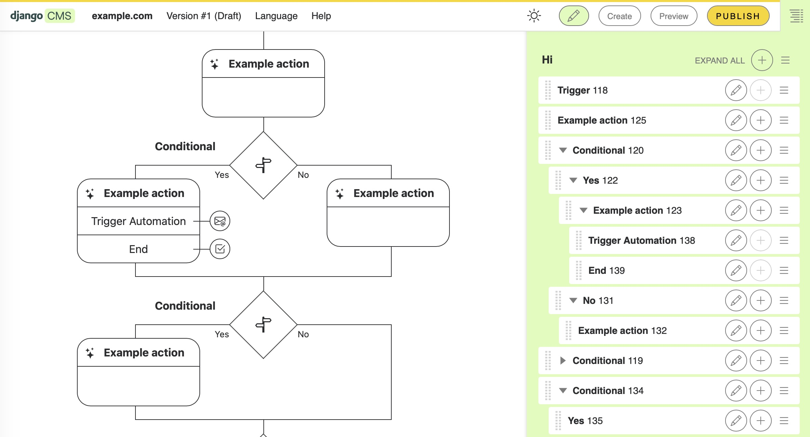

djangocms-automation
====================

[](https://pypi.org/project/djangocms-automation/)
[](https://pypi.org/project/djangocms-automation/)
[](https://pypi.org/project/djangocms-automation/)
[](https://codecov.io/gh/fsbraun/djangocms-automation)
[](https://github.com/fsbraun/djangocms-automation/blob/main/LICENSE)

**Edit workflows the same way you edit pages.**

In djangocms-automation a workflow is built exactly like a django CMS page:
open it in the frontend editor, add plugins, drag them into place and
configure them right there. Anyone who can edit a page already knows how to
edit an automation. There is no second tool to learn.

That matters because this kind of logic (routing a contact form, qualifying a
lead, sending a nightly digest, ingesting an order from a webhook) usually ends
up as one-off Python that only a developer can change, or in a separate
automation service with its own interface, logins and copy of your data. Here
it stays in your Django project, and runs durably there.



- **The page editor is the workflow editor.** Triggers, conditions and actions
  are CMS plugins, so the structure board, drag & drop and plugin forms work
  as they do for content.
- **Triggers.** Form submissions, timers, inbound webhooks (optionally
  HMAC-signed), inbound mail, a manual *Run now…*, or your own code.
- **Flow control.** If/Then/Else with a visual condition builder, bounded
  loops, and parallel paths that join automatically.
- **Actions.** Send email, create, update and query Django records (behind an
  allowlist), pause for a person's approval, or write your own in Python.
- **AI steps that stay in bounds.** *Ask a Model* calls any provider through
  [LiteLLM](https://docs.litellm.ai/). Actions placed inside it become the
  model's tools, each call is an inspectable step that can wait for human
  approval, and token, tool-call and time limits fail the run instead of
  returning a half-answer.
- **Durable execution without a broker.** The queue is your database. Work
  survives restarts and killed workers, failures retry with backoff, and
  exhausted actions are dead-lettered and can be replayed from the admin.
  Every run keeps its frozen definition and execution trace.

**Documentation:** <https://djangocms-automation.readthedocs.io/> ·
[Getting started](docs/source/tutorials/getting-started.rst) ·
[Deployment](docs/source/howto/deployment.rst)

**Status:** pre-alpha (0.1.0) and not yet on PyPI. It needs Python 3.12+,
Django 6.0+ and django CMS 5.1+. Calling an external HTTP API from an
automation is not built yet; see the notes under
[What it looks like in practice](#what-it-looks-like-in-practice).

Installation
------------

Install the package from GitHub:

```bash
pip install git+https://github.com/fsbraun/djangocms-automation.git
```

Add `djangocms_automation` to your `INSTALLED_APPS`:

```python
INSTALLED_APPS = [
    # ...
    "djangocms_automation",
    # ...
]
```

Run migrations:

```bash
python manage.py migrate djangocms_automation
```

### Running Automations

A production deployment runs three processes: the **web** server enqueues work
but never executes it, one or more **workers** execute it, and a **scheduler**
fires timers, revives retries, and recovers work whose worker died.

```python
TASKS = {
    "default": {
        "BACKEND": "djangocms_automation.backends.DatabaseBackend",
        "QUEUES": ["default"],
    }
}
```

```bash
python manage.py runworker                 # one or more; add more for throughput

* * * * * cd /path/to/project && python manage.py runautomations   # every minute
```

`DatabaseBackend` is durable: enqueued work is a database row claimed under a
lease, so it survives a restart and a killed worker's task is released and
retried. Django's built-in `ImmediateBackend` executes inline (fine for tests,
not for production) and `djangocms_automation.utils.ThreadBackend` runs tasks in
an in-process thread pool that is lost on exit — development only.

**Reliability.** Actions carry attempt counts, execution leases, timeouts, and
a full state-transition history. Failures are retried according to a per-plugin
`RetryPolicy` with exponential backoff and jitter; retries are distinguished
from re-entries, so a split or a paused action never consumes its retry budget.
Actions that exhaust their attempts, or whose worker died with no attempts left,
are dead-lettered and can be replayed from the admin without editing the
database. Running executions can be canceled. The scheduler may run on several
hosts — it takes a database lock, so exactly one tick happens at a time.

See the [deployment guide](docs/source/howto/deployment.rst) for the full
contract, settings, retention, and health signals.

### Trying it out

The repository ships a demo project running the full production shape against
SQLite:

```bash
cd demo
python manage.py migrate
python manage.py seedautomations    # admin/admin, plus reference automations
python manage.py runserver
python manage.py runworker          # in a second shell
```

`seedautomations --scenario killed-worker` (and `timeout`,
`enqueue-rejection`, `duplicate-webhook`, `timer-backlog`) injects failure
conditions so recovery can be watched rather than only trusted.

### What it looks like in practice

Every automation below is seeded by `seedautomations` and runs against the
bundled `dummy/echo` model, so none of them needs an API key or an account
anywhere.

| Example | What it shows | |
|---|---|---|
| **Intelligent contact form** | A form submission, a model deciding what the message is about, and a conditional routing it to billing or support | ✅ |
| **Editorial AI review** | A model drafting a change to an article, a person seeing the exact wording it chose, and nothing written until they approve | ✅ |
| **Lead qualification** | A model scoring a lead, the score written back to the record, and sales told about the good ones | ✅ |
| **Nightly content digest** | A recurring timer, a query, and one email per item — with bounded catch-up after downtime | ✅ |
| **Webhook order ingest** | An outside service starting a workflow over HTTP, idempotently, with retries, dead letters and replay | ✅ |

Two notes so this does not read as more than it is:

- The **contact form** automation is complete and runnable, but the form itself
  is yours to draw: give a [djangocms-form-builder](https://github.com/fsbraun/djangocms-form-builder)
  form the *Trigger automation* action and point it at the seeded *Form
  Submission* trigger. Without that, trigger it by hand with the same fields.
- **Calling out to an external API is not built yet.** Webhooks work *inbound*
  — anything can start an automation over HTTP — but there is no HTTP action, so
  an automation cannot yet call a service back. Until there is, that half is a
  Python action you write (see *Writing your own action* in the
  [actions guide](docs/source/howto/actions.rst)).

### Running one by hand

*Automation → Run now…* in the toolbar starts a run there and then, which is
how you try an automation just after building it. Pick the trigger, give it the
items to start with as a JSON array, and it goes — a real run, so mail is sent,
records are written, and anything needing approval waits for a person under
*Execution Instances → Open tasks*.

The items are checked against the trigger's data schema first, exactly as an
inbound webhook's would be, so a manual run cannot prove an automation works on
data the real entry point would refuse.

It needs permission to add an execution instance, and it is queued like any
other run: the worker has to be going (`python manage.py runworker`, or
`runworker --once` to drain and stop).

### Pointing it at a real model

Everything above runs on `dummy/echo`, which answers locally. To use a real
provider:

```bash
pip install "djangocms-automation[llm] @ git+https://github.com/fsbraun/djangocms-automation.git"
```

```python
INSTALLED_APPS = [..., "djangocms_automation", "djangocms_automation.ai"]

# An allowlist: a step may only name a model that appears here. Each entry is
# the model string and the label an editor picks from — a bare string also
# works and labels itself.
AUTOMATION_LLM_MODELS = [
    ("anthropic/claude-opus-4-8", "Claude Opus — best quality, costs money"),
    ("dummy/echo", "No provider"),
]
AUTOMATION_LLM_DEFAULT = "anthropic/claude-opus-4-8"
```

Model strings are LiteLLM's `<provider>/<model>` — see
[LiteLLM's provider list](https://docs.litellm.ai/docs/providers) for the exact
name of any model it supports.

**The key goes in the database, not in settings.** In the admin, under
*Automations → Secrets*, add an API key with **Service** set to the part of the
model string *before* the slash — `anthropic` for the example above — and leave
it active. The package reads no environment variable and no settings value for
this — a step without a stored key fails with a message saying so, rather than
quietly picking one up from the environment.

Allowing a model is what makes its provider appear in that dropdown, so any
provider LiteLLM supports works without registering anything: put
`("deepseek/deepseek-chat", "DeepSeek")` in the allowlist and `deepseek` is
offered as a Service. To give it a nicer label than its own id, register it —
`service_registry.register("deepseek", "DeepSeek")` from
`djangocms_automation.services`, in your app's `AppConfig.ready()`.

Then open any *Ask a Model* step and pick the model in its **Model** field. The
seeded automations all name `dummy/echo`, so switching one over is a single
field. In the demo project the allowlist is in `demo/demoproject/settings.py`.

Two things change when a real model answers. The `!call` directives in a task
do nothing — those are instructions to the stand-in, and a real model decides
for itself what to call. And the run costs money, so the step's **Maximum
tokens** and **Maximum tool calls** stop being theoretical: set them before the
first run, not after.

### Built-in actions

- **Send Email** — one email per item via Django's email framework.
- **Create / Update / Query Records** — Django model CRUD, gated by the `AUTOMATION_ALLOWED_MODELS` setting.
- **Ask a Model** — provider-independent LLM calls via [LiteLLM](https://docs.litellm.ai/). Install with `pip install djangocms-automation[llm]` and add `"djangocms_automation.ai"` to `INSTALLED_APPS`; models via `AUTOMATION_LLM_MODELS`, API keys in the admin *Secrets* store. On its own it answers a question; put actions inside it and it becomes an agent.
- **Wait for User** — human-in-the-loop pause/resume from the admin.

- **Tools are actions.** Any action placed inside an *Ask a Model* step is offered to the model, with a switch beside each of its inputs saying whether you bind it or the model fills it — so it can write an email's subject and body while the recipient stays bound to your expression. Nothing extra to write: a third-party action becomes a tool with no work by anyone. Every tool call is a first-class execution step, inspectable, retryable, and pausable for human approval before anything irreversible runs. Bounded by turns, tool calls, tokens and wall clock; reaching a limit fails the run rather than returning a confident half-answer.

Flow control includes conditionals (If/Then/Else with a visual condition builder), while loops with a bounded iteration count, parallel splits with automatic joins, and timer/form/manual/code/webhook triggers.

### Webhooks

Include `path("automation/", include("djangocms_automation.urls"))` in your urlconf, then give an automation a *Webhook* trigger: any service can start it by POSTing JSON to the trigger's secret URL (`/automation/webhook/<token>/`), optionally authenticated with an HMAC signing secret. The *Mail* trigger builds on this for inbound email — point your mail provider's webhook at it and filter by recipient/subject/status. Custom webhook trigger types are a small `WebhookTrigger` subclass away.

Concepts
--------

One unit of automation data is an **item**, its named values are **fields**,
and a list of items is a **batch**. A field can itself contain a list, such as
an order's lines. Each instance processes one item; actions preserve its fields
and save named results into explicit destinations. Batches and batch intake are
deferred. Completed runs retain their frozen definition and execution trace for
debugging, subject to retention.

See [Reading an automation](docs/source/explanation/reading-an-automation.rst)
and the [glossary](docs/source/glossary.rst).

Documentation
-------------

The full documentation is at <https://djangocms-automation.readthedocs.io/>.
To build it locally:

```bash
cd docs
make install    # creates the docs virtual environment
make html
open _build/html/index.html
```
